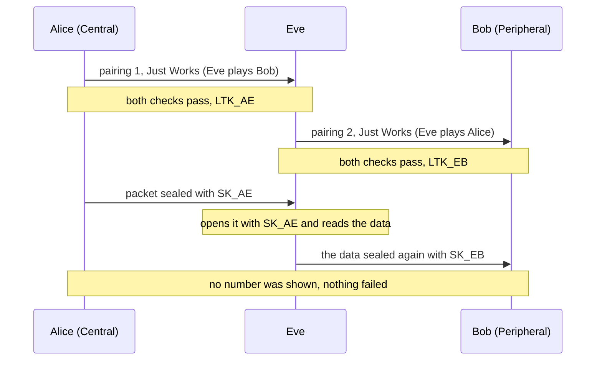

# Just Works man in the middle

| | |
|---|---|
| Scenario | `uv run python -m bt54 just-works-mitm` |
| Target | LE Secure Connections pairing with the Just Works method |
| Class | active man in the middle, no protocol flaw: Just Works is *unauthenticated by design* |
| Spec | Core v5.4 Vol 3 Part H §2.3.1, §2.3.5.1 (Table 2.8), §2.3.5.6.2 |

## Summary

Just Works pairs two devices without showing the user anything to check. An attacker who sits between them can pair
with each one separately. Both pairings succeed, the attacker holds both Long Term Keys, and neither victim has
any sign that something is wrong. The specification says it plainly: "Unauthenticated no MITM Protection does not
have protection against MITM attacks" (§2.3.1).

## Threat model

- **Alice** (Central) and **Bob** (Peripheral) want to pair. **Eve** is an active attacker within radio range: she
  can answer Alice's connection as if she were Bob, and connect to Bob as if she were Alice.
- Eve can run the protocol, store keys and send packets. She does not need to break any cryptography.

## Preconditions

1. The pairing method is Just Works. By Table 2.8 that is what happens when neither device sets the MITM flag, or
   when one of them is `NoInputNoOutput` (a sensor, a tag, a speaker): the IO capabilities leave no way to show or
   confirm a number.
2. Eve is the one Alice connects to, for example by being closer or by advertising first. Winning that race on a real
   radio is outside this simulation.

## Proof of concept

```
$ uv run python -m bt54 just-works-mitm
just-works-mitm
  Eve read: secret LE data
  expected: paired with both victims; Eve reads and relays the packet
  actual:   paired with both victims; Eve reads and relays the packet
  PASS
```

What the scenario does (`src/bt54/__main__.py`, `_mitm`):



1. `exchange(alice, eve)` and `exchange(eve, bob)` run two ordinary pairings, then `authenticate` on each: all
   checks (Cb, Ea, Eb) pass because each pairing is honest.
2. Each link gets its own session key, `SK = e(LTK, SKD)`. Alice seals one packet with her key.
3. The scenario first checks that forwarding the ciphertext **unchanged** to Bob fails: the two keys differ, so the MIC
   fails. A man in the middle that only forwards would break the link.
4. So Eve opens the packet with `SK_AE`, reads it, seals it with `SK_EB` and sends it on. Bob decrypts the plaintext.
   If the two links shared a key, the scenario would report `no MitM` instead.

## Impact

Eve reads and can change everything on the link: the keys she holds let her encrypt and authenticate any packet in
both directions. If the devices bond, the keys are stored and the attack persists after the pairing. Key material
that is later shared over the link, such as the key of [Encrypted Advertising Data](../ead.md), is exposed too.
The attack costs one pairing per victim.

## Mitigation and detection

- **Do not use Just Works for data that matters.** Set the MITM flag and use Numeric Comparison, Passkey Entry or
  Out of Band, as far as the IO capabilities allow (Table 2.8). A device that needs an authenticated key must refuse a
  result that does not give it: Pairing Failed, *Authentication Requirements* (§2.3.5.1).
- **Out of Band** through a channel the attacker cannot reach (NFC, a code on the device) when the device has no
  display.
- **Pair only on demand** (a button, a pairing window), and show the user which device is pairing.
- **Slow down repeated attempts**: after a failure the waiting interval grows exponentially, and a device should change
  its private key after failures (§2.3.6).
- **Detection inside the protocol is not possible**: both pairings succeed. Only a check outside it helps, for example
  an application that compares a value shown on both devices.

## Limits of the simulation

- No radio: Eve is assumed to be accepted by both sides, with no race, no jamming and no address spoofing.
- Pairing is simulated from public keys onwards; the devices read the same objects, so an attacker that alters
  the IO capabilities or addresses cannot be modelled yet (step 6).
- LE Legacy Just Works (TK = 0, §2.3.5.2) is a different and weaker case: it is a planned scenario.

## References

Core v5.4 Vol 3 Part H §2.3.1 (security properties), §2.3.5.1 and Table 2.8 (method selection), §2.3.5.6.2 (stage 1),
§2.3.6 (repeated attempts). Related: Method Confusion, von Tschirschnitz et al., IEEE S&P 2021
([references](../references.md)). Overview of the pairing: [pairing](../pairing.md).
