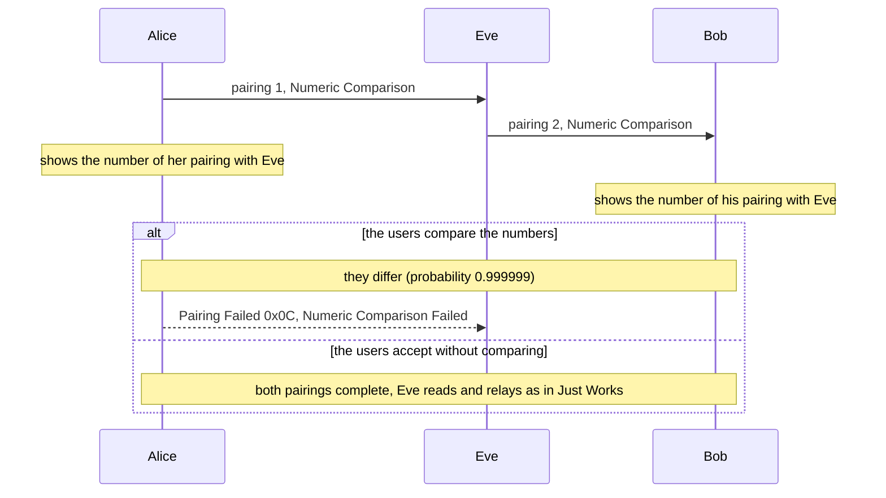

# Numeric Comparison man in the middle

| | |
|---|---|
| Scenarios | `uv run python -m bt54 numeric-comparison-mitm` (users compare), `numeric-comparison-mitm-blind` (users accept) |
| Target | LE Secure Connections pairing with the Numeric Comparison method |
| Class | active man in the middle; the defence is a human check, so it fails when the human does not check |
| Spec | Core v5.4 Vol 3 Part H §2.3.5.6.2, §2.3.6, §3.5.5 |

## Summary

Numeric Comparison is the authenticated answer to [Just Works](just-works-mitm.md): both devices show a 6-digit number
and the users confirm that the two match. An attacker who pairs separately with each victim produces two different
numbers, so the users notice, with probability 0.999999 per attempt. If the users tap "yes" without comparing, the
attack works exactly as in Just Works.

## Threat model

Same as the [Just Works attack](just-works-mitm.md): Eve is between Alice (Central) and Bob (Peripheral) and pairs with
each. The difference is that both devices have a display and a yes/no input (`DisplayYesNo`, `KeyboardDisplay`;
Table 2.8), so the stage 1 values `Va` and `Vb` are shown.

## Preconditions

1. Both devices set MITM and have IO capabilities that select Numeric Comparison.
2. For the attack to succeed: the users accept without comparing the numbers (the "blind" scenario), *or* the two
   numbers happen to match (probability 10^-6 per attempt).

## Proof of concept

```
$ uv run python -m bt54 numeric-comparison-mitm
numeric-comparison-mitm
  Alice sees 776951, Bob sees 117249
  expected: pairing failed: NUMERIC_COMPARISON_FAILED
  actual:   pairing failed: NUMERIC_COMPARISON_FAILED
  PASS

$ uv run python -m bt54 numeric-comparison-mitm-blind
numeric-comparison-mitm-blind
  Alice sees 366552, Bob sees 245315
  Eve read: secret LE data
  expected: paired with both victims; Eve reads and relays the packet
  actual:   paired with both victims; Eve reads and relays the packet
  PASS
```



The two numbers come from two different pairings (different keys, different nonces), so they are independent
6-digit values. In the scenario the "users" are a flag: when they compare, the scenario makes sure the two numbers
differ (see below) and the pairing ends with `PairingFailed(NUMERIC_COMPARISON_FAILED)`; in the blind variant nothing
is compared and Eve relays a packet, with the same two-session-key proof as in the Just Works scenario.

The collision case (10^-6) is redrawn in the scenario so that its outcome is deterministic. In the real attack a
collision lets Eve through, and she may try again.

## Why a MitM cannot choose the numbers

The Peripheral commits to its nonce with `Cb` before the Central reveals `Na` (stage 1). The specification:
"A simple MITM attack will result in the two 6-digit display values being different with probability 0.999999. A
more sophisticated attack may attempt to engineer the display values to match, but this is thwarted by the
commitment sequence" (§2.3.5.6.2). Eve cannot pick her nonces after seeing the others, so each attempt is a
10^-6 guess.

## Impact

With "compare" the attack is detected and costs Eve a failed pairing. With "accept blindly" the impact is the same as
for Just Works: Eve reads and changes the traffic, and stored bonding keys make it persistent.

## Mitigation and detection

- **Users must compare the numbers**, and the interface must make that the default action: a "confirm" button with
  the two numbers side by side, not a bare "pair?" prompt.
- **Slow attackers down.** After a failed pairing a device waits before it accepts a new attempt, and the interval
  grows exponentially; a device should change its private key after every pairing, and otherwise whenever
  `S + 3F > 8` (S successes, F failures since the last change) (§2.3.6). One guess in a million at a growing delay is not a practical attack.
- **A failure is a signal**: Pairing Failed 0x0C (*Numeric Comparison Failed*) and 0x04 (*Confirm Value Failed*) point
  to an attacker or a transmission error (§2.3.5.6.2) and are worth logging.
- Passkey Entry and Out of Band bind the pairing to a secret instead of a comparison.

## Limits of the simulation

- The users are a boolean (compare or not); there is no usability model, which is where this defence really fails.
- No radio, no race for the connection; the devices read the same objects, so IO capability tampering and a
  Method Confusion attack (a Numeric Comparison on one side, Passkey Entry on the other) are not modelled (step 6).
- One simulated attempt: the exponential delay and the key change policy are described, not simulated.

## References

Core v5.4 Vol 3 Part H §2.3.5.6.2, §2.3.6, §3.5.5 (Pairing Failed reason codes). Related: Method Confusion, von
Tschirschnitz et al., IEEE S&P 2021 ([references](../references.md)). Overview: [pairing](../pairing.md).
