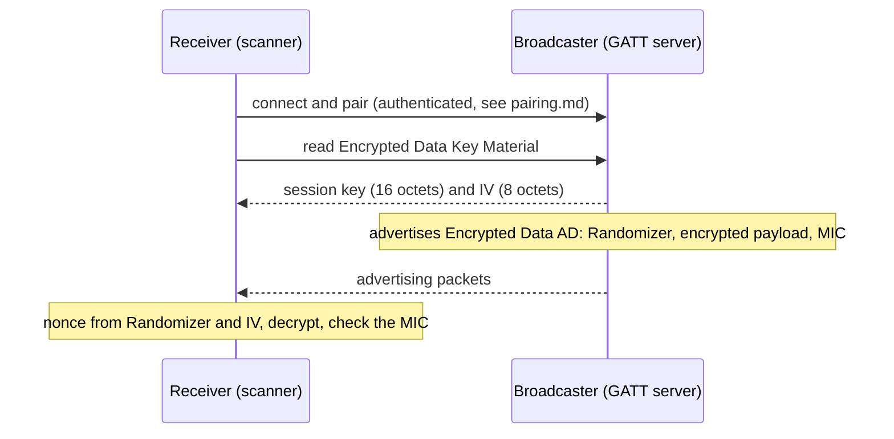

# Encrypted Advertising Data (EAD)

Advertising packets are public: anyone in radio range reads them. Bluetooth Core 5.4 added the **Encrypted Data** AD
type so a Broadcaster can encrypt and authenticate advertising data for the receivers that hold a key. Sources:
Core Specification Supplement v11 (CSS) Part A §1.23, Core v5.4 Vol 3 Part C §10.10 and §12.6, Vol 6 Part E §1.
The encryption is the same AES-CCM as the Link Layer's, see [ccm](ccm.md). EAD is **not implemented in `bt54` yet**
(roadmap step 6), but its specification sample data already passes on the existing CCM code
(`tests/test_ccm.py::test_encrypted_data_matches_the_css_sample_data`).

## 1. The Encrypted Data AD type (CSS §1.23)

| Octets | Field |
|---|---|
| 0 to 4 | Randomizer (5 octets) |
| 5 to L+4 | Payload: one or more AD structures, encrypted (L octets) |
| L+5 to L+8 | MIC (4 octets) |

The Payload and MIC are encrypted with the CCM of Vol 6 Part E §1, with four changes (§1.23.3):

1. the `packetCounter` of the CCM nonce is the **Randomizer**, and the `directionBit` is the Randomizer's most
   significant bit (the nonce layout of [ccm](ccm.md) holds exactly 40 bits for the two);
2. the **session key** is set by a higher layer or negotiated between the devices; any key with at least 128 bits of
   entropy may be used;
3. the **IV** of the nonce is set the same way;
4. in the `B1` block, octet 2 is `0xEA`, so the AAD is the single octet `0xEA`.

**Security properties** (§1.23.4): the Randomizer must change every time the payload or the random device address
changes, and the IV every time the session key changes. A Randomizer that is not random can be used to track the
device. Reusing a (key, Randomizer) pair reuses the CTR keystream, as for any CCM nonce.

## 2. Sample data

CSS §2.3.1 (Set 1): Randomizer `0xDECA57E118`, IV `0x46E77AB1EF007A9E`, session key
`0x57A9DA12D12E6E131E20612AD10A6A19`; the Encrypted Data AD data is
`18E157CADE 74E4DCAFDC51C7282810C2217F0E4CEF4343181F BA0069CC` (Randomizer, encrypted payload, encrypted MIC), with the
Randomizer least significant octet first. Opening it with `ccm.decrypt`, with the nonce
`ccm.ll_nonce(Randomizer & (2^39 - 1), Randomizer >> 39, IV)` and the AAD `0xEA`, verifies the MIC and gives the
AD structures `0F 09 "Short Mini-Bus"` (Complete Local Name) and `03 19 0A8C` (Appearance). Set 2 (§2.3.2) uses the
same key and IV with Randomizer `0x7A6E971C8D` and gives the same payload.

## 3. Sharing the key: Encrypted Data Key Material (Vol 3 Part C §12.6)

The key reaches the receiver through a GATT characteristic of the Generic Access service, *Encrypted Data Key
Material* (UUID `0x2B88`):

| Field | Octets | Meaning |
|---|---|---|
| Session Key | 16 | the shared session key |
| IV | 8 | the initialization vector |

It is **readable only when authenticated and authorized**, may be indicated when it changes, and is **not writable**;
the server should update it periodically. A scanning device that wants to read the advertising data connects, reads
the characteristic and stores the key material (§10.10).

The key material is protected by the pairing: a receiver is only as trustworthy as the authentication used to pair
with it. A pairing done with Just Works gives no protection against a man in the middle (see
[the Just Works MitM](attacks/just-works-mitm.md)), and that man in the middle would read the key material.

## 4. Why this design

The specification does not give its reasons; this is the reading the project uses. A scanner receives each
advertisement alone, with no connection and no counter shared with the sender. So the format carries its own
nonce part (the Randomizer) in every packet, and the two devices share one session key and one IV. CCM is safe with
one key ([ccm](ccm.md)), so no second key and no encrypt-then-MAC construction is needed. The 2024 report of this
project said the standard's best practices could not be followed; that was too strong: it is a format choice
(key material = a 16-octet key and an 8-octet IV), not a limit.

## 5. Periodic Advertising with Responses (PAwR)

Core 5.4 introduced two features, EAD and PAwR. PAwR (Vol 6 Part B §4.4.2.2.4) is advertising at a fixed interval
with data that changes often, where synchronized devices can answer: an event has up to 128 *subevents*, each with an
`AUX_SYNC_SUBEVENT_IND` PDU followed by response slots in `AUX_SYNC_SUBEVENT_RSP` PDUs, and a device may respond in at
most one slot per subevent. The Core text read for this project does not tie EAD to PAwR: they are two features,
and a profile can combine them. The Electronic Shelf Label profile, built on PAwR, protects its commands with AES-CCM through EAD,
according to the Bluetooth SIG (see [references](references.md)).

## 6. In `bt54`

Done: the two sample sets pass as tests on the existing CCM. Planned for step 6: an `ead` module (build and open
the AD structure) and the misuse scenarios (a repeated Randomizer leaks the XOR of two payloads; a fixed Randomizer
makes the device trackable).
