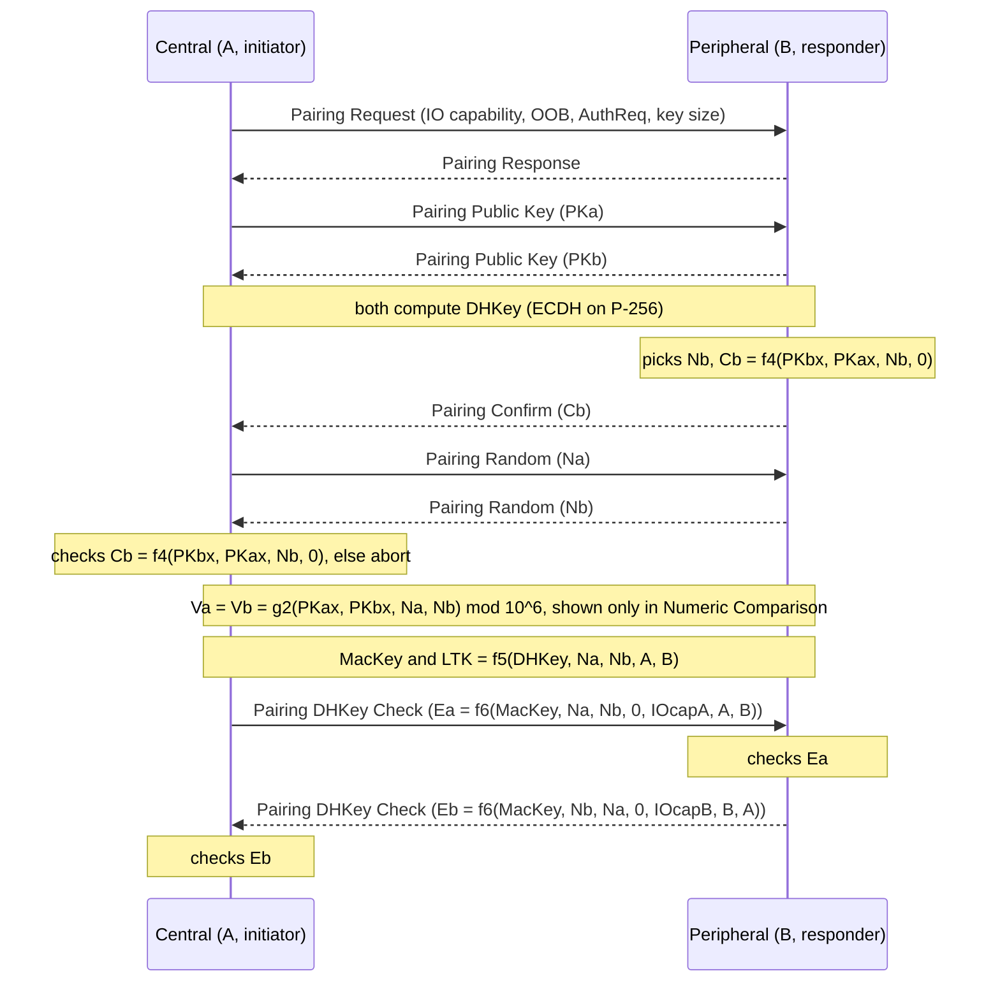
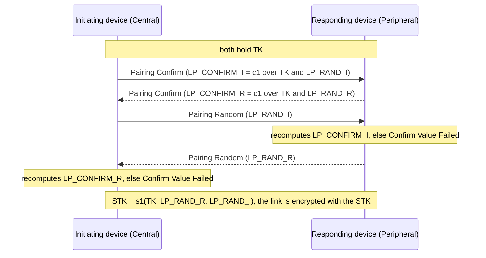

# LE pairing

How two Bluetooth LE devices agree on a key. Source: Core v5.4 Vol 3 Part H (Security Manager). The code that
simulates it is `src/bt54/toolbox.py` (the crypto functions), `src/bt54/device.py` and `src/bt54/pairing.py`; the
toolbox functions are checked against the specification's sample data (Appendix D, the `c1` and `s1` examples, Vol 6
Part C). Only LE Secure Connections is simulated; Legacy Pairing exists as the `c1` and `s1` functions.

Pairing has three phases: **1. feature exchange**, **2. authentication and key generation** (this is where
Legacy Pairing and LE Secure Connections differ), **3. key distribution** (not covered here).

## 1. Phase 1: Pairing Feature Exchange

The Central sends a *Pairing Request*, the Peripheral answers with a *Pairing Response*. Both have the same 7 octets
(`c1` takes them as `preq` and `pres`):

| Field | Octets | Meaning |
|---|---|---|
| Code | 1 | Pairing Request or Response |
| IO Capability | 1 | what the device can show and ask the user (below) |
| OOB data flag | 1 | `0x00` OOB authentication data not present, `0x01` OOB data from the remote device present |
| AuthReq | 1 | authentication requirements (below) |
| Maximum Encryption Key Size | 1 | 7 to 16 octets |
| Initiator / Responder Key Distribution | 1 + 1 | which keys each side will send in phase 3 |

**IO Capability** (§3.5.1, Table 3.4): `0x00` DisplayOnly, `0x01` DisplayYesNo, `0x02` KeyboardOnly,
`0x03` NoInputNoOutput, `0x04` KeyboardDisplay. In code: `bt54.device.IOCap`.

**AuthReq** (§3.5.1, Figure 3.3), least significant bit first. In code: `bt54.device.AuthReq`.

| Bits | Flag | Meaning |
|---|---|---|
| b1:b0 | Bonding_Flags | `00` no bonding, `01` bonding, `10` and `11` reserved |
| b2 | MITM | the device asks for protection against a man in the middle |
| b3 | SC | the device supports LE Secure Connections |
| b4 | Keypress | only used by Passkey Entry, ignored otherwise |
| b5 | CT2 | shall be 1 on transmission to say the device supports `h7` (cross-transport key derivation) |
| b7:b6 | RFU | reserved |

## 2. Choosing the pairing method

**Legacy or Secure Connections.** "If both devices support LE Secure Connections pairing, then LE Secure Connections
pairing shall be used, otherwise LE Legacy pairing shall be used" (§3.5.1, SC field). `bt54` simulates Secure Connections and refuses a pairing where SC is missing.

**Which method.** Three rules, then a table (§2.3.5.1, Tables 2.6 to 2.8):

1. If the Secure Connections pairing has out-of-band data on at least one side, use **Out of Band** and ignore the
   other flags (Legacy: only when *both* sides have it).
2. Else if neither device set MITM, ignore the IO capabilities and use **Just Works**.
3. Else use the IO capabilities in the table below (rows: Responder, columns: Initiator).

| Responder \ Initiator | DisplayOnly | DisplayYesNo | KeyboardOnly | NoInputNoOutput | KeyboardDisplay |
|---|---|---|---|---|---|
| **DisplayOnly** | JW | JW | PE: responder shows | JW | PE: responder shows |
| **DisplayYesNo** | JW | JW (Legacy), NC (SC) | PE: responder shows | JW | PE (Legacy) or NC (SC) |
| **KeyboardOnly** | PE: initiator shows | PE: initiator shows | PE: both type | JW | PE: initiator shows |
| **NoInputNoOutput** | JW | JW | JW | JW | JW |
| **KeyboardDisplay** | PE: initiator shows | PE (Legacy) or NC (SC) | PE: responder shows | JW | PE (Legacy) or NC (SC) |

*JW* = Just Works (unauthenticated), *NC* = Numeric Comparison, *PE* = Passkey Entry (both authenticated). If the
result gives less protection than the device needs, it sends Pairing Failed with the reason "Authentication
Requirements".

## 3. LE Secure Connections (Phase 2)

Every device has a P-256 key pair. The result is a 128-bit Long Term Key (LTK).

**Stage 1** (Figure 2.3, Just Works and Numeric Comparison). The Peripheral commits to its nonce with `Cb` before the
Central reveals `Na`, so nobody can pick a nonce after seeing the other's. The Central checks `Cb` in *both* methods
(step 6a). In Numeric Comparison each device shows the 6-digit `g2` value and each user confirms that the two
match; in Just Works nothing is shown. A failed `Cb` check ends with Pairing Failed 0x04 *Confirm Value Failed*;
0x0C *Numeric Comparison Failed* means "the confirm values in the numeric comparison protocol do not match"
(Table 3.7), which is what `bt54` reports when the users find the two numbers different.

**Stage 2** (§2.3.5.6.5). Both sides compute `MacKey || LTK = f5(...)`, then the Central sends `Ea` and the
Peripheral checks it, then the Peripheral sends `Eb` and the Central checks it. `IOcap` is the three octets
AuthReq, OOB flag, IO capability, so the check also binds those values. Failure gives 0x0B *DHKey Check Failed*.

**Public keys** (§2.3.5.6.1). A device must check that a received key is on P-256 (an implementation that does not
is open to the invalid curve attack, CVE-2018-5383) and fails the pairing if the peer's X coordinate equals its own.
`bt54` raises `InvalidPublicKey`.

**What the numbers protect.** "A simple MITM attack will result in the two 6-digit display values being different with
probability 0.999999" (§2.3.5.6.2); the commitment stops an attacker from choosing nonces to make them match. After a
failure the device must wait before accepting a new attempt, and the wait grows exponentially (§2.3.6). Just Works
has no such protection: see [the Just Works MitM](attacks/just-works-mitm.md) and
[the Numeric Comparison MitM](attacks/numeric-comparison-mitm.md).

Passkey Entry and Out of Band are not simulated yet.

## 4. Encryption key size

Each device has a maximum encryption key size between 7 and 16 octets. The shorter of the two maxima is used
(§2.3.4). If it is below a device's own minimum, that device sends Pairing Failed 0x06 *Encryption Key Size*.
`bt54` fixes that minimum at 7 octets for both devices.

A key longer than the agreed size is masked **after it is generated**: the most significant octets are set to 0.
Example from the specification, a 128-bit key reduced to 7 octets:
`12345678_9ABCDEF0_12345678_9ABCDEF0` becomes `00000000_00000000_00345678_9ABCDEF0` (`pairing.mask_key`). The
BR/EDR rule is the opposite: there the *least* significant octets are zeroed (see [KNOB](attacks/knob.md)).

Neither `f5` nor `f6` takes the key size as input, so the checks of stage 2 do not cover it; an active attacker
who changes the unauthenticated key size field can lower it. This is the basis of the LE key size downgrade
described by Antonioli et al. (see [references](references.md)); it is not simulated yet.

## 5. LE Legacy Pairing (Phase 2)

The result is a Short Term Key (STK), made from a 128-bit Temporary Key (TK).

- **TK** (§2.3.5.2 to §2.3.5.4). Just Works: TK = 0. Passkey Entry: TK is a passkey between 000000 and 999999 shown
  by one device and typed on the other (for example the passkey `019655` gives TK `0x...4CC7`). Out of Band: TK is a
  128-bit random number received out of band.
- **Confirm values** (§2.3.5.5). Each side picks a 128-bit random (`LP_RAND_I` for the initiating device,
  `LP_RAND_R` for the responding one) and computes a confirm value (`LP_CONFIRM_I`, `LP_CONFIRM_R`) with `c1` over
  TK, its random, the Pairing Request and Response commands and both address types and addresses.

Because TK has at most six digits (or is 0), an eavesdropper who records the pairing can try every TK offline.
That is the Legacy TK brute force (the `crackle` tool); it is a planned scenario, not simulated yet. `c1` and `s1`
exist in the toolbox and pass the specification's examples (§2.2.3, §2.2.4).
